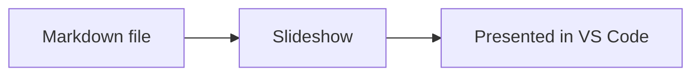
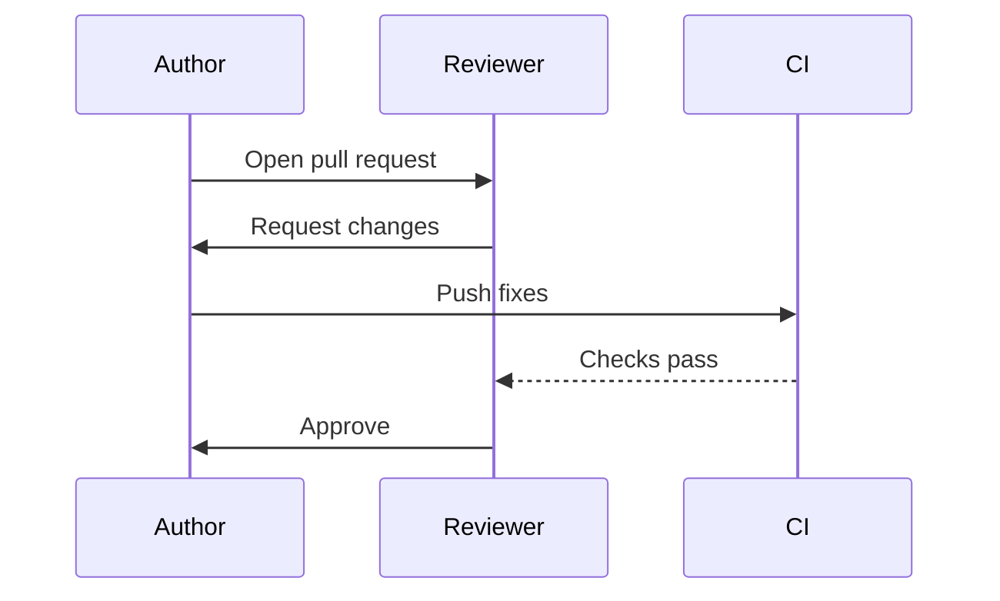

# Showcase deck

This file is the source of the README screenshots. Text outside the slide pairs, like this paragraph, never appears in the slideshow.

To retake the screenshots, run `node scripts/render-harness.js` and follow the steps in `docs/development.md`.

<!-- slide -->

# Present Markdown in VS Code

Mark the slides in a plain-text file and present them beside your editor.

- **No export step:** the slides stay in the Markdown file you already edit
- **Live:** the slideshow updates as you type
- **Diagrams:** Mermaid renders from the same file



<!-- /slide -->

<!-- slide -->

## Mermaid diagrams

Write a diagram in a backtick fence or in an Azure DevOps `::: mermaid` block. Both render the same way.



<!-- /slide -->

<!-- slide -->

## Mark slides with HTML comments

Only the text between the two markers becomes a slide.

```markdown
Notes and drafts stay outside the markers.

<!-- slide -->

# My first slide

Welcome to the presentation.

<!-- /slide -->
```

The markers are comments, so other Markdown previews hide them.

<!-- /slide -->

<!-- slide -->

## Markdown rendering

Headings, lists, **bold**, _italic_ and `inline code` render as you expect.

1. Write the slide
2. Check it beside the source
3. Present

```js
function greet(name) {
  return `Hello, ${name}`;
}
```

<!-- /slide -->

<!-- slide -->

## Settings

Alignment, font size, background color, the slide counter and the navigation arrows are settings.

- `markdownPresentation.slide.fontSize`
- `markdownPresentation.slide.backgroundColor`
- `markdownPresentation.slide.headingAlignment`

<!-- /slide -->
