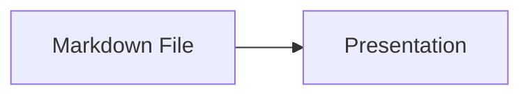

# Markdown Presentation Tool for VS Code

**Present a Markdown file as a slide deck without leaving VS Code.**

[Markdown Presentation Tool](https://marketplace.visualstudio.com/items?itemName=KunalPathak.markdown-presentation-tool) turns the slides you mark in a Markdown file into a navigable slideshow beside your editor. It suits documentation, meeting notes, and architecture diagrams, and it needs no export step. The slides stay in the same plain-text file you already edit, and the slideshow updates as you type.


## Install

- **From the Marketplace:**
  - Open the [Markdown Presentation Tool page](https://marketplace.visualstudio.com/items?itemName=KunalPathak.markdown-presentation-tool) and select **Install**.
  - Or search for "Markdown Presentation Tool" in the VS Code Extensions view.
- **Requirements:**
  - The current stable release of VS Code, or any older release back to the `engines.vscode` floor in [package.json](package.json).
  - Internet access when a slide contains a Mermaid diagram (see [Privacy and security](#privacy-and-security)).

## Use

1. **Mark your slides.** Put `<!-- slide -->` on its own line to open a slide and `<!-- /slide -->` on its own line to close it.
2. **Open the Markdown file** in VS Code.
3. **Start the presentation** in either of two ways:
   - Select the **Presentation icon** in the editor title bar.
   - Open the Command Palette (`Cmd+Shift+P` or `Ctrl+Shift+P`) and run `Markdown: Show Markdown Presentation`.

Only text inside an open/close pair becomes a slide. Notes, drafts, and reminders outside the pairs stay in the editor.

````markdown
<!-- slide -->

# My First Slide

Welcome to the presentation!

<!-- /slide -->

Speaker notes, draft text, or reminders can live here.
They stay in the editor and never appear in the slideshow.

<!-- slide -->

# Mermaid Diagrams Also Work Natively



- Images from the web work too!

<!-- /slide -->

- Content outside slide tags is not shown during the presentation.
- Keep speaker notes, prompts, or draft edits in the same file without leaking them onto slides.
````

A file with no `<!-- slide -->` line shows one slide per Mermaid diagram and ignores the text around the diagrams.

### Navigation

| Action               | Input                                                              |
| :------------------- | :----------------------------------------------------------------- |
| **Next slide**       | `Right Arrow`, `Down Arrow`, `PageDown`, `Space`, or scroll down   |
| **Previous slide**   | `Left Arrow`, `Up Arrow`, `PageUp`, or scroll up                   |
| **Scroll in a slide**| `Shift` + scroll, for slides taller than the panel                 |
| **On-screen arrows** | Select the arrows at the panel edges                               |

### Settings

Open VS Code Settings (`Cmd+,` or `Ctrl+,`) and search for **Markdown Presentation Tool**.

| Category       | Setting                                           | Default   | Description                                                  |
| :------------- | :------------------------------------------------ | :-------- | :----------------------------------------------------------- |
| **Mermaid**    | `markdownPresentation.slide.mermaidTheme`         | `default` | `default` (follows the VS Code theme), `dark`, `forest`, or `neutral` |
| **Appearance** | `markdownPresentation.slide.headingAlignment`     | `left`    | `left`, `center`, or `right`                                 |
| **Appearance** | `markdownPresentation.slide.contentAlignment`     | `left`    | `left`, `center`, or `right`                                 |
| **Appearance** | `markdownPresentation.slide.fontSize`             | `medium`  | `small` (0.85em), `medium` (1em), or `large` (1.25em)        |
| **Appearance** | `markdownPresentation.slide.backgroundColor`      | _(empty)_ | A hex, named, or functional CSS color such as `#1e1e1e`; other values are ignored |
| **UI**         | `markdownPresentation.slide.showCounter`          | `true`    | Show the slide counter in the bottom-right corner            |
| **UI**         | `markdownPresentation.slide.showNavigationArrows` | `true`    | Show the on-screen navigation arrows                         |

## Features

- **Editor integration:**
  - The slideshow opens beside your editor and needs no configuration.
  - Edits to the source file appear in the slideshow while you type.
  - The slide position survives switching tabs and changing settings.
- **Markdown rendering:**
  - Headings, paragraphs, bullet and numbered lists (one level), blockquotes, and horizontal rules.
  - Bold, italic, inline code, and fenced code blocks.
  - Images from `https://` addresses, one image per line.
- **Diagrams:**
  - Mermaid diagrams render from backtick fences and from Azure DevOps `::: mermaid` fences.
  - A diagram error or an unreachable network affects that diagram only. Text slides keep working.
- **Appearance:**
  - Slides follow your VS Code light or dark theme.
  - Settings control alignment, font size, background color, and the on-screen controls.
- **Clean source files:**
  - The slide tags are HTML comments, so other Markdown previews hide them.
- **Not supported:**
  - Tables, clickable links, nested lists, and images from local file paths.
  - [decisions.md](docs/decisions.md) records why.

## Privacy and security

- **Network use:**
  - A slide with a Mermaid diagram loads one pinned Mermaid version from `cdn.jsdelivr.net`.
  - A slide with an `https://` image requests that image from the host in the address.
  - The extension makes no other network requests and sends no telemetry.
- **Local access:**
  - The extension reads the Markdown file you present and your Markdown Presentation settings. It writes no files.
- **Content handling:**
  - Document text is escaped before it enters the slide page.
  - The page runs under a strict Content Security Policy that allows only its own script and the pinned Mermaid directory.
  - Mermaid runs at its default `strict` security level.
- **Settings input:**
  - The extension accepts only known values for enumerated settings and a plain CSS color for the background.
  - It ignores any other value.

## Contribute

- **Set up and release:** [docs/development.md](docs/development.md) covers local setup, checks, CI, and the release process.
- **Understand the design:** [docs/architecture.md](docs/architecture.md) explains slide extraction, rendering, and the panel lifecycle.
- **Verify a change:** [docs/testing.md](docs/testing.md) maps each workflow to its checks.
- **Keep dependencies current:** [docs/dependencies.md](docs/dependencies.md) holds the version and support policy.
- **Review deferred ideas:** [docs/decisions.md](docs/decisions.md) lists features that are intentionally not built, with the conditions that would reopen them.
- **Report an issue:** use the [issue tracker](https://github.com/kanad13/markdown-presentation-tool/issues).
